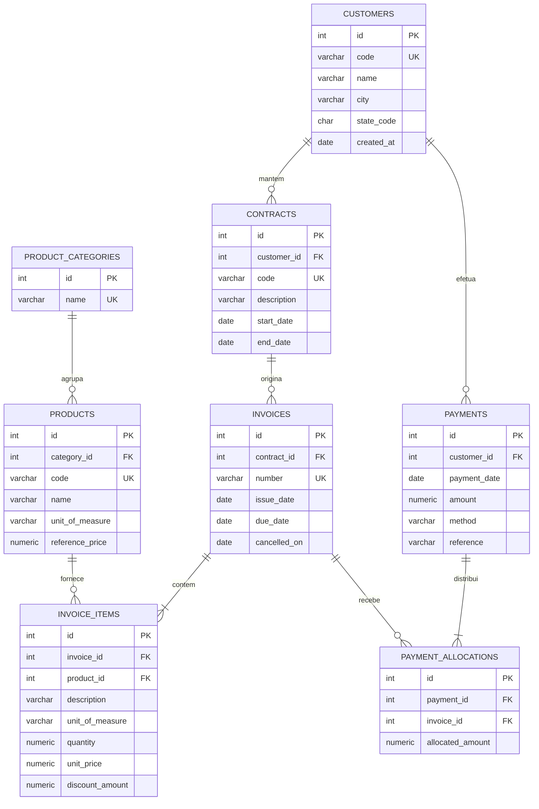

# Modelo de dados e regras de negócio

Aqui está a arquitetura do modelo relacional, entidades, regras de cálculo financeiro e faixas de conciliação por data de corte do schema `billing` usado neste projeto.

---

## Diagrama entidade-relacionamento

[Ver este diagrama detalhadamente](https://dataxstudios.com.br/br/apps/markdown-studio/#c=pZTBjtowEIbvPIXFfV-gtyibVlEXgiBU6sky9sBawnY6Ga-Elr57FZM4CYRl2-ZC-Oef8Tf2xIDPWhxQmBljjKXbTVkssvWGnc9PT-6dpcWyXCdpuWFf2NwIS2Dm085V8nORLS9G2AN5cTGu1sXzNi15mpTZt2KdZ33GJRIyxAF9Nc6Ivnz5o8jTjOdltgjmvUMLElqQSDi2B6dDfdC2rRsDjfE8UVe6vr-RuW-PJy8vRZqUebEMKQgSdi1J3IG2_p0UpWtCvfN6Prvayffwv3m0JaYVW32PyptA-SqQSaeAbW91KwzcmjWdohiUmgQBb4pEXQkCJhEEgeKCgv57du_sPsPYsHSM40of5zeKFAQHhyeuFfv6n-17q4m7PTcgao993HoDqCVD2AOClcAr1BKGvP1UPQT2NTkD-JfACmqJuiLt7PgkahJIvHkd62BVr7aUcUgfQjpLKCTdgbTe7ACHmGFJXdceJlDUpCqFlXA8guJtS2PI9jN7RKrtm9MSrkCbSIVO-bstTO3nZ-fglxeWhp9KFwiJ_WwMQ0rX0nlLXJjmZzTr3T3wj6MTdrMSJwP2ahC6xQdrDvs0QK9O3chxzCcgR5fTI96O6fZspk8t4h6PTl6ul8Fm_QE&theme=default)

---

## Dicionário de entidades

### `billing.customers`

Cadastro de clientes empresariais: restaurantes, pizzarias, padarias, hotéis e empórios.

- `id` (INTEGER, PK): Identificador sequencial primário.
- `code` (VARCHAR(20), UNIQUE): Código único do cliente (`C001` a `C040`).
- `name` (VARCHAR(150)): Razão social / nome fantasia corporativo.
- `city` (VARCHAR(100)): Município.
- `state_code` (CHAR(2)): Unidade federativa.
- `created_at` (DATE): Data de cadastro comercial.

### `billing.product_categories`

Categorias do catálogo de produtos de distribuição alimentar:

1. Mercearia Seca
2. Laticínios e Frios
3. Bebidas e Sucos
4. Embalagens e Descartáveis
5. Higiene e Limpeza Profissional

- `id` (INTEGER, PK): Identificador da categoria.
- `name` (VARCHAR(100), UNIQUE): Nome descritivo da categoria.

### `billing.products`

Catálogo de mercadorias comercializadas no atacado.

- `id` (INTEGER, PK): Identificador do produto.
- `category_id` (INTEGER, FK -> `product_categories.id`): Categoria à qual pertence.
- `code` (VARCHAR(30), UNIQUE): Código SKU do produto (`ALM-001` a `ALM-015`).
- `name` (VARCHAR(150)): Descrição comercial da mercadoria.
- `unit_of_measure` (VARCHAR(10)): Unidade comercial padrão (`FD`, `GL`, `UN`, `CX`, `PCT`).
- `reference_price` (NUMERIC(14,2)): Preço unitário base de tabela (BRL).

### `billing.contracts`

Acordos comerciais e contratos de fornecimento contínuo por cliente.

- `id` (INTEGER, PK): Identificador do acordo comercial.
- `customer_id` (INTEGER, FK -> `customers.id`): Cliente titular.
- `code` (VARCHAR(30), UNIQUE): Identificador do contrato (`CTR-001` a `CTR-060`).
- `description` (VARCHAR(255)): Escopo do acordo de fornecimento.
- `start_date` (DATE): Início da vigência do acordo.
- `end_date` (DATE, opcional): Término da vigência (NULL para fornecimento continuado).

### `billing.invoices`

Faturas e cobranças de pedidos faturados contra contratos vigentes.

- `id` (INTEGER, PK): Identificador do documento fiscal/cobrança.
- `contract_id` (INTEGER, FK -> `contracts.id`): Acordo vinculado.
- `number` (VARCHAR(30), UNIQUE): Número da fatura (`DEMO-001` a `DEMO-006` para C001, `INV-000007` a `INV-000600`).
- `issue_date` (DATE): Data de emissão.
- `due_date` (DATE): Data de vencimento original (`due_date >= issue_date`).
- `cancelled_on` (DATE, opcional): Data de cancelamento, se aplicável (`cancelled_on >= issue_date`).

### `billing.invoice_items`

Itens e mercadorias discriminados em cada fatura.

- `id` (INTEGER, PK): Identificador da linha.
- `invoice_id` (INTEGER, FK -> `invoices.id`): Cobrança à qual pertence.
- `product_id` (INTEGER, FK -> `products.id`): Mercadoria faturada.
- `description` (VARCHAR(255)): Descrição do item faturado.
- `unit_of_measure` (VARCHAR(10)): Unidade comercial faturada.
- `quantity` (NUMERIC(10,2)): Quantidade fornecida.
- `unit_price` (NUMERIC(14,2)): Preço unitário praticado.
- `discount_amount` (NUMERIC(14,2)): Desconto comercial concedido na linha (`discount_amount <= quantity * unit_price`).

### `billing.payments`

Liquidações financeiras recebidas via instituições bancárias.

- `id` (INTEGER, PK): Identificador da transação financeira.
- `customer_id` (INTEGER, FK -> `customers.id`): Cliente titular do pagamento.
- `payment_date` (DATE): Data efetiva da liquidação.
- `amount` (NUMERIC(14,2)): Montante total recebido no lote/documento.
- `method` (VARCHAR(50)): Forma de liquidação (`Boleto Bancário`, `PIX`, `TED`).
- `reference` (VARCHAR(100)): Autenticação bancária / comprovante de liquidação.

### `billing.payment_allocations`

Alocação dos valores recebidos às respectivas faturas amortizadas.

- `id` (INTEGER, PK): Identificador da alocação.
- `payment_id` (INTEGER, FK -> `payments.id`): Liquidação de origem.
- `invoice_id` (INTEGER, FK -> `invoices.id`): Fatura amortizada.
- `allocated_amount` (NUMERIC(14,2)): Parcela aplicada à fatura (`allocated_amount > 0`).

---

## Regras de cálculo financeiro

1. **Campos monetários**
   Uso exclusivo de `NUMERIC(14,2)` para valores financeiros e `NUMERIC(10,2)` para quantidades.

2. **Valor bruto da linha**
   $$\text{Bruto} = \operatorname{ROUND}(\text{quantity} \times \text{unit\_price}, 2)$$

3. **Valor líquido da linha**
   $$\text{Líquido} = \text{Bruto} - \text{discount\_amount}$$

4. **Total líquido da cobrança**
   $$\text{Total Cobrança} = \sum_{\text{itens}} \text{Líquido}$$

5. **Total recebido na data de corte ($p\_as\_of\_date$)**
   Soma das alocações cujos pagamentos tenham ocorrido até a data de corte, inclusive:
   $$\text{Recebido}(p\_as\_of\_date) = \sum_{p.payment\_date \le p\_as\_of\_date} pa.allocated\_amount$$

6. **Saldo da cobrança na data de corte**
   $$\text{Saldo}(p\_as\_of\_date) = \text{Total Cobrança} - \text{Recebido}(p\_as\_of\_date)$$

7. **Critério de inadimplência / atraso**
   Uma cobrança é considerada vencida se possuir saldo positivo e vencimento estritamente anterior à data de corte:
   $$\text{Saldo}(p\_as\_of\_date) > 0 \quad \text{e} \quad \text{due\_date} < p\_as\_of\_date$$

8. **Cancelamentos**
   Cobranças com `cancelled_on <= p_as_of_date` são excluídas das totalizações de contas a receber e faturamento válido.

---

## Classificação por daixas de atraso/aging

Para análise de cobranças e relatórios de aging, os documentos com saldo em aberto são distribuídos em 5 faixas:

| Ordem (`aging_bucket_order`) | Faixa (`aging_bucket_label`) | Regra Temporal                                |
| :--------------------------: | ---------------------------- | --------------------------------------------- |
|            **1**             | A Vencer / No Vencimento     | `due_date >= p_as_of_date`                    |
|            **2**             | 1 a 30 dias                  | `(p_as_of_date - due_date) BETWEEN 1 AND 30`  |
|            **3**             | 31 a 60 dias                 | `(p_as_of_date - due_date) BETWEEN 31 AND 60` |
|            **4**             | 61 a 90 dias                 | `(p_as_of_date - due_date) BETWEEN 61 AND 90` |
|            **5**             | Acima de 90 dias             | `(p_as_of_date - due_date) > 90`              |

---

## Views de suporte aos relatórios

- **`billing.v_invoice_lines`**
  Granularidade de item faturado, com dados do cliente, contrato, produto, categoria e valores calculados.

- **`billing.v_invoice_totals`**
  Granularidade de fatura, consolidando contagem de itens, total bruto, desconto e líquido.

- **`billing.v_payment_allocations`**
  Granularidade de alocação de liquidação, com dados do pagamento e da fatura amortizada.
